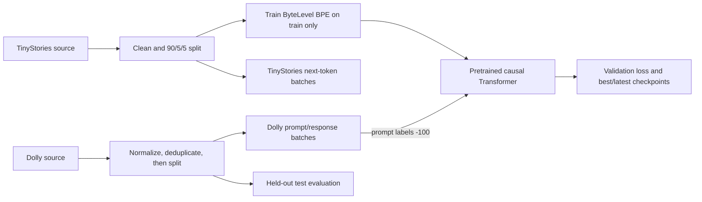

# Member 2 viva notes

## Implemented pipeline

Preprocess TinyStories and Dolly separately; split records; train/validate an 8,000-token ByteLevel BPE; make fixed-length PyTorch datasets; fine-tune the shared causal Transformer on Dolly with response-only loss; preserve local data and verification records. Actual local checks: 52 tests passed, tokenizer checks passed, Dolly split overlap check passed. SFT was not run because the pretrained checkpoint is absent. Actual dataset and filtering counts are in `../logs/member2_dataset_validation.json`.

## Likely questions and answers

1. **What did you implement?** Preprocessing, tokenizer training/validation, PyTorch datasets, SFT training integration, logging and artifact documentation.
2. **Why TinyStories for pretraining?** It provides simple, short narratives suited to training a small model's next-token language modeling behavior within limited compute.
3. **Why Dolly for SFT?** It contains instruction/response examples that teach the pretrained model to answer user requests.
4. **Why three splits?** Train updates weights; validation guides model selection; test estimates performance on data not used for either.
5. **Why deduplicate prompts?** The same instruction in multiple splits could leak its answer into training and make held-out scores misleading.
6. **How are prompts normalized?** Trim and collapse whitespace, format, then case-fold the full prompt to make comparison insensitive to spacing and case.
7. **How are response conflicts resolved?** Keep one deterministically selected canonical response/category (lexicographically smallest), independent of input order.
8. **What does ByteLevel BPE do?** It starts from byte-level units and repeatedly merges frequent adjacent units into subword tokens, covering arbitrary text without an unknown byte sequence.
9. **Why vocabulary 8,000?** It is the project's shared fixed vocabulary: a practical size for this small model and the agreed model/tokenizer interface.
10. **What is BOS?** Beginning-of-sequence marker.
11. **What is EOS?** End-of-sequence marker; in Dolly it is a supervised target.
12. **What is PAD?** A fixed ID (0) used to make batch sequences equal length; its attention and loss are masked.
13. **What is UNK?** Unknown-token fallback (ID 1), though byte-level coverage reduces its use.
14. **What is SEP?** Separator for paired tokenizer inputs (ID 4).
15. **What do input IDs, labels and attention mask mean?** IDs are token indices; labels are desired next-token targets; mask marks real tokens (1) versus padding (0).
16. **How does next-token prediction work?** At each position the causal model predicts the following token; labels are shifted one position relative to inputs.
17. **Why mask prompt labels with -100?** PyTorch cross-entropy ignores -100, so prompt tokens condition generation without being scored as desired outputs.
18. **What is response-only loss?** Cross-entropy averaged over shifted response and EOS targets, excluding prompt and padding positions.
19. **How are long Dolly examples handled?** Keep full prompt, truncate response to available space while reserving EOS; skip if prompt plus EOS cannot fit.
20. **How is the pretrained model loaded?** Read checkpoint config, build with `src.model:build_model`, check vocabulary/context, and strictly load its state dict.
21. **What does AdamW do?** It applies adaptive gradient updates with decoupled weight decay to trainable parameters.
22. **How is validation loss used?** Evaluate without gradients each epoch; save the checkpoint with the lowest validation loss as best.
23. **How are checkpoints preserved?** Keep best/latest plus config and machine-readable epoch log; back up existing outputs before replacement and checksum artifacts.
24. **What results were actually obtained?** 52 repository tests passed; tokenizer and split validation passed. No SFT losses/checkpoints exist because no compatible pretrained checkpoint was available.
25. **What are limitations and next steps?** Obtain Member 1's checkpoint, run SFT and held-out evaluation, upload the local preservation folder to shared Drive and verify hashes. Original tokenizer training lineage is declared by config/source, not proven by a recorded training run.
